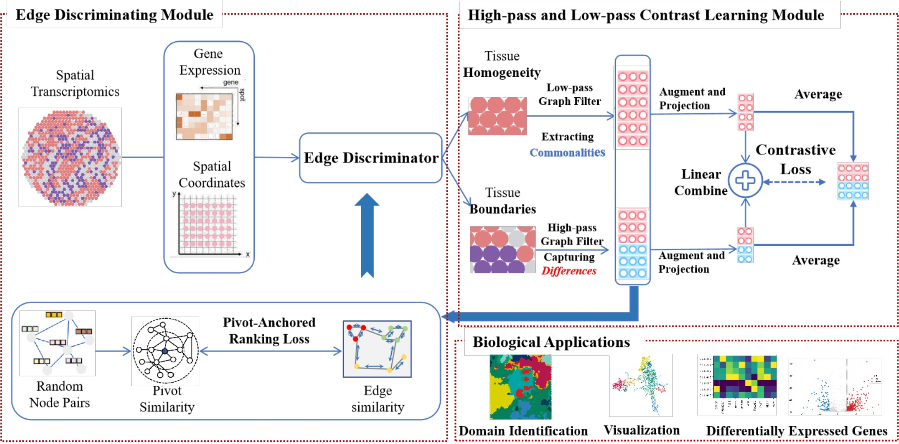

### SHARP
A spectral heterophily-aware self-supervised graph representation framework for spatially resolved transcriptomics (SRT).
SHARP disentangles spatial topology into homophilic (low-pass) and heterophilic (high-pass) views, then fuses frequency-aware embeddings for spatial domain identification and boundary recovery.


### Quick Result Validation Procedure for reviewers

## Environment Setup

1. **Create a conda environment**

```bash
conda create -n sharp python=3.9 -y
```

2. **Activate the newly created environment**:

```bash
conda activate sharp
```

3. **Install pip packages**:

```bash
pip install -r requirements.txt
```

Install PyTorch, DGL, and PyTorch Geometric wheels that match your CUDA version when the generic `pip` packages are incompatible.
Also install the R package `mclust` (used only for standardized ARI evaluation):

```bash
conda install -c conda-forge r-mclust rpy2 -y
```

---

## GPU Settings

Set `-gpu` to the visible device index used by your machine, for example:

```bash
python main.py -dataset BRCA -gpu 0 ...
```

---

## License
This project is released under the MIT License. See `LICENSE.md`.

## Dependencies
* python==3.9.18
* anndata==0.10.9
* numpy==1.26.4
* pandas==2.0.3
* rpy2==3.5.11
* scanpy==1.9.3
* scikit-learn==1.6.1
* scikit-misc==0.3.1
* scipy==1.13.1
* torch==1.11.0
* dgl==0.8.0
* torch-geometric==2.0.4
* umap-learn==0.5.9.post2
* matplotlib==3.9.4
* seaborn==0.13.2 <br>

The packages above are the main packages used in our experiments. Most CUDA-compatible PyTorch environments can run the code directly; we also provide `./requirements.txt` for convenience.

## Data
Raw datasets are **not** redistributed in this repository. Please download the four benchmarks from their original public sources and place them as follows:

```text
data/
├── BRCA/Breast_Caner/
│   ├── filtered_feature_bc_matrix.h5
│   └── spatial/
│       ├── tissue_positions_list.csv
│       ├── brca_ground_truth_annotation.csv
│       └── scalefactors_json.json
├── E18.5_mouse_brain/
│   └── E18_adata_rna.h5ad
└── Stereo/
    ├── Stereo_AB.h5ad
    └── Stereo_DPI.h5ad
```

### Download sources
* **BRCA (10x Visium / Visium CytAssist human breast cancer)**  
  10x Genomics public datasets: https://www.10xgenomics.com/datasets  
  (search *Visium CytAssist Human Breast Cancer*).  
  GEO example: https://www.ncbi.nlm.nih.gov/geo/query/acc.cgi?acc=GSM7782699

* **Mouse E18.5 Brain (MISAR-seq RNA)**  
  Jiang et al., *Nature Methods*, 2023: https://www.nature.com/articles/s41592-023-01884-1  
  Project page: https://www.biosino.org/node/project/detail/OEP003285  
  Companion release: https://zenodo.org/record/7714382  
  Save the RNA AnnData as `data/E18.5_mouse_brain/E18_adata_rna.h5ad` (annotation field: `Combined_Clusters`).

* **Stereo_AB (ARTISTA Adult telencephalon)**  
  ARTISTA download: https://db.cngb.org/stomics/artista/download/  
  Download `Adult.h5ad` and place/rename to `data/Stereo/Stereo_AB.h5ad` (annotation field: `Annotation`).  
  Dataset page: https://db.cngb.org/stomics/datasets/STDS0000056

* **Stereo_DPI (ARTISTA 2DPI regeneration)**  
  ARTISTA download: https://db.cngb.org/stomics/artista/download/  
  Download the corresponding `2DPI_*.h5ad` section and place/rename to `data/Stereo/Stereo_DPI.h5ad`  
  (annotation field: `ground_truth` or `Annotation`).

See `./data/README.txt` for a concise checklist.

## Quick start

Use Anaconda to create a Python virtual environment:

```cmd
conda create -n sharp python=3.9 -y
conda activate sharp
```

Install packages:

```cmd
pip install -r requirements.txt
conda install -c conda-forge r-mclust rpy2 -y
```

Then reproduce the four benchmarks:

```cmd
sh run.sh
```

Or run a single dataset:

```cmd
python main.py -dataset BRCA -k 10 -refine_k 5 -margin_hom 0.6 -margin_het 0.4 -alpha 0.1 -temp_disc 0.7 -output_dir results/BRCA
```

Quantification visualizations will be saved in `./results`:

```text
<dataset>_best_spatial.png
<dataset>_best_umap.png
```

## Params setting for Best results on each dataset in our environment settings

# BRCA
| dataset | k | refine_k | margin_hom | margin_het | alpha | temp_disc | lr_gcl | lr_disc | Reported ARI (paper) |
|---------|---|----------|------------|------------|-------|-----------|--------|---------|----------------------|
| BRCA | 10 | 5 | 0.6 | 0.4 | 0.1 | 0.7 | 1e-4 | 1e-4 | 0.4552 ± 0.0166 |

# Mouse E18.5
| dataset | k | refine_k | margin_hom | margin_het | alpha | temp_disc | lr_gcl | lr_disc | Reported ARI (paper) |
|---------|---|----------|------------|------------|-------|-----------|--------|---------|----------------------|
| E18_mouse_brain | 10 | 5 | 0.3 | 0.7 | 0.1 | 1.0 | 1e-4 | 1e-4 | 0.4543 ± 0.0145 |

# Stereo_AB
| dataset | k | refine_k | margin_hom | margin_het | alpha | temp_disc | lr_gcl | lr_disc | Reported ARI (paper) |
|---------|---|----------|------------|------------|-------|-----------|--------|---------|----------------------|
| Stereo_AB | 12 | 15 | 0.6 | 0.4 | 0.2 | 0.7 | 1e-4 | 1e-4 | 0.5074 ± 0.0152 |

# Stereo_DPI
| dataset | k | refine_k | margin_hom | margin_het | alpha | temp_disc | lr_gcl | lr_disc | Reported ARI (paper) |
|---------|---|----------|------------|------------|-------|-----------|--------|---------|----------------------|
| Stereo_DPI | 20 | 15 | 0.5 | 0.5 | 0.15 | 1.0 | 2e-4 | 2e-4 | 0.4088 ± 0.0156 |

Default training schedule: `epochs=600`, `eval_freq=20`, `cl_rounds=2`, `emb_dim=512`, `proj_dim=512`, `nlayers_enc=2`, `nlayers_proj=1`, `dropout=0.5`, `sparse=1`.

## Applying SHARP to Custom Datasets

Prepare an AnnData / Visium-style input with spatial coordinates and labels (if evaluation is needed), place it under `./data/`, and extend `data_loader.py` / `load_data()` accordingly. Then run:

```cmd
python main.py -dataset <DATASET_NAME> -k <spatial_knn> -refine_k <label_refine_knn> -margin_hom <hom_margin> -margin_het <het_margin> -alpha <hp_scale> -temp_disc <temperature> -output_dir results/<DATASET_NAME>
```

## Reference
[1] J. Liu et al., “Decoding Spatial Heterophily: A Spectral Graph Contrastive Method for Spatially Resolved Transcriptomics,” IEEE BIBM, 2026.

[2] S. Jiang et al., “Simultaneous profiling of spatial gene expression and chromatin accessibility during mouse brain development,” Nature Methods, 2023. (MISAR-seq / Mouse E18.5)

[3] X. Wei et al., “Single-cell Stereo-seq reveals induced progenitor cells involved in axolotl brain regeneration,” Science, 2022. (ARTISTA / Stereo_AB & Stereo_DPI)

[4] K. Dong and S. Zhang, “Deciphering spatial domains from spatially resolved transcriptomics with an adaptive graph attention auto-encoder,” Nature Communications, vol. 13, no. 1, p. 1739, 2022.

[5] Y. Long et al., “Spatially informed clustering, integration, and deconvolution of spatial transcriptomics with GraphST,” Nature Communications, vol. 14, no. 1, p. 1155, 2023.

[6] Y. Liu, Y. Zheng, D. Zhang, V. C. Lee, and S. Pan, “Beyond smoothing: Unsupervised graph representation learning with edge heterophily discriminating,” AAAI, 2023.

[7] W. Yang and B. Mirzasoleiman, “Graph contrastive learning under heterophily via graph filters,” arXiv:2303.06344, 2023.

## Acknowledgment
Parts of the graph contrastive design are inspired by heterophily-aware graph representation learning methods such as GREET / HLCL-style edge discrimination and spectral filtering.
